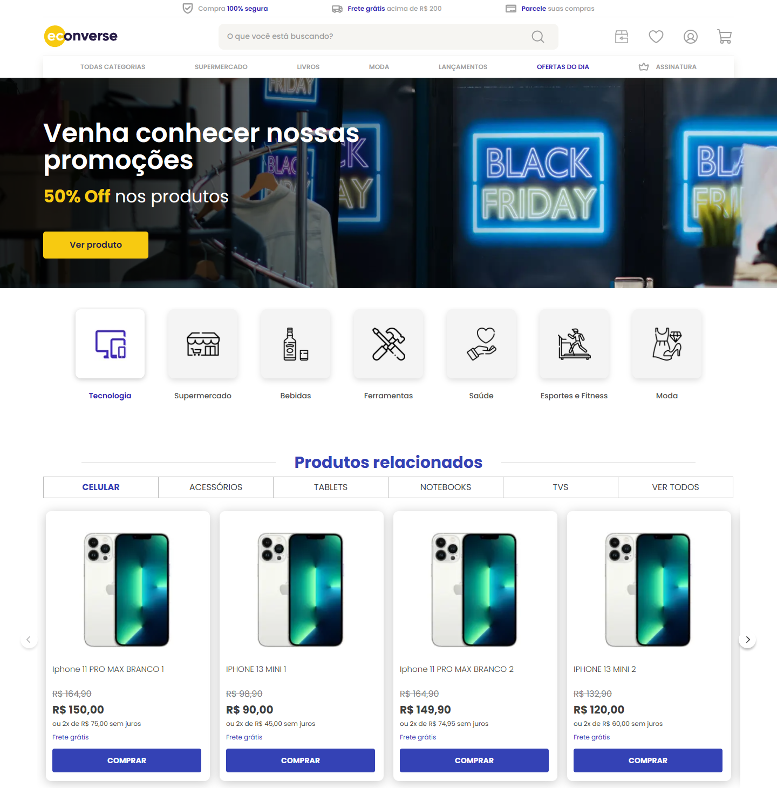
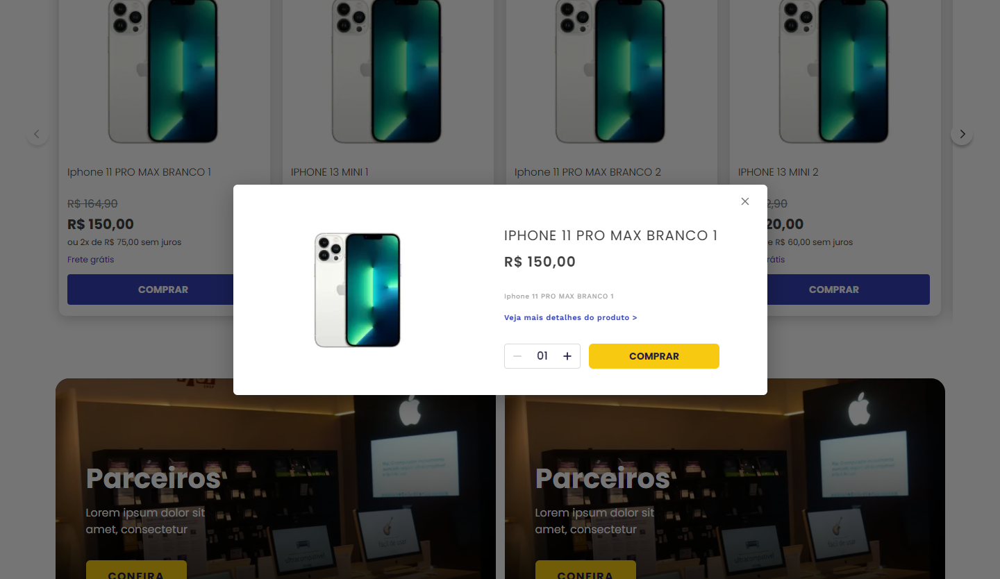

# Econverse: vitrine de produtos

Teste para a vaga de **Desenvolvedor Front-End** da Econverse. Página de loja em **React + TypeScript** com a vitrine
"Produtos relacionados" consumindo o [JSON de produtos](https://app.econverse.com.br/teste-front-end/junior/tecnologia/lista-produtos/produtos.json)
e um **modal com as informações do produto** ao clicar nele.

> Decisões e prós/contras: [`docs/DECISOES.md`](docs/DECISOES.md) ·
> Medidas, cores e fontes lidas do Figma: [`docs/LAYOUT.md`](docs/LAYOUT.md)

| Topo e vitrine (1440 px) | Modal do produto |
| --- | --- |
|  |  |

Página inteira: [`docs/screenshots/pagina-inteira.png`](docs/screenshots/pagina-inteira.png) · celular: [`docs/screenshots/mobile.png`](docs/screenshots/mobile.png)

## O que tem

| Requisito do teste | Onde está |
| --- | --- |
| React e TypeScript conforme o layout | Next.js 16 (App Router), React 19, TypeScript `strict` + `noUncheckedIndexedAccess` |
| Vitrine consumindo o JSON pelo link | `src/lib/products.ts`: busca no servidor, valida com zod, cache de 1 h (ISR) |
| Modal com as informações do produto clicado | `src/components/showcase/ProductModal.tsx`: `<dialog>` nativo (foto, nome, preço, descrição, quantidade, comprar), como o frame "Popup" do Figma |
| Pré-processador Sass | SCSS Modules por componente + tokens e mixins em `src/styles/` |
| Layout pixel a pixel: fontes, cores, botões | Valores lidos do Figma pela API (frames "Home" e "Popup"), assets originais exportados de lá; cada bloco fica a até 2px da posição do Figma em 1440 px, e o e2e confere tamanho e posição dos cards |
| Sem bibliotecas de UI | Nenhuma: ícones em SVG (os do Figma), carrossel com `scroll-snap`, modal com `<dialog>` |
| Extra: SEO | HTML já vem com os produtos (renderizado no servidor), `<title>`/description/canonical/Open Graph, JSON-LD `ItemList` de `Product` com preço, `robots.txt`, `sitemap.xml`, `lang="pt-BR"`, imagens otimizadas (`next/image`) e fonte sem layout shift (`next/font`) |
| Extra: HTML semântico | `header`/`nav`/`main`/`section`/`article`/`footer`, um único `h1`, hierarquia de títulos, `form role="search"`, `<s>` no preço antigo |
| Também | Acessibilidade (abas WAI-ARIA com setas/Home/End, foco preso e Esc no modal, link "pular para o conteúdo", `prefers-reduced-motion`), responsivo do celular ao desktop, estado de erro se a API cair |

## Como rodar

Pré-requisito: **Node.js 22 ou superior** (testado com 24).

```bash
npm install
npm run dev          # http://localhost:3000
```

Build de produção:

```bash
npm run build
npm start            # http://localhost:3000
```

Opcional: `NEXT_PUBLIC_SITE_URL=https://seu-dominio` para canonical, Open Graph e sitemap apontarem para o domínio real.

## Testes

```bash
npm run lint && npm run typecheck
npm test             # unitários (Vitest + Testing Library): preço, parcelas, parsing do JSON, categorias, SEO,
                     # vitrine (cards, abrir/fechar modal, quantidade, abas pelo teclado, API fora do ar)
npm run build && npm run test:e2e
                     # ponta a ponta (Playwright) contra o build de produção, em 1440 px e em celular:
                     # HTML com produtos e JSON-LD, modal (clique, Esc, clique fora, foco devolvido),
                     # tamanho do card igual ao layout, seta do carrossel, sem rolagem horizontal no celular
```

Sem acesso para baixar o navegador do Playwright, use um Chrome já instalado:
`PW_CHROMIUM_PATH="C:/Program Files/Google/Chrome/Application/chrome.exe" npm run test:e2e`.

## Estrutura

```
src/
  app/                    layout (fontes, metadados), página, robots, sitemap, 404
  components/
    showcase/             vitrine: Showcase (estado), CategoryTabs, Carousel, ProductCard, ProductModal, QuantityStepper
    layout/               Header e Footer
    home/                 HeroBanner, DepartmentNav, Partners, Brands
    brand/, icons/        logo (SVG do Figma) e ícones (figma-icons.tsx gerado dos SVGs do Figma)
  lib/                    regras puras: products (busca + validação), price, categories, seo
  styles/                 _tokens.scss (cores, fontes, medidas) e _mixins.scss (breakpoints, botão, foco)
tests/unit, tests/e2e     Vitest e Playwright · tests/fixtures/produtos.json é cópia do JSON real
public/                   logo e imagens exportadas do Figma (banner, parceiros, ícones das categorias)
docs/                     decisões, medidas do layout, renders do Figma, capturas
```

## Limitações conhecidas

- **Figma × PNG:** o PNG da vitrine citado no enunciado (rosa) é da página "Antigo" do Figma. Implementei a página
  **"Home"** (azul e amarelo), que é a versão atual do layout. Detalhes em [`docs/LAYOUT.md`](docs/LAYOUT.md).
- **Preço "de":** o JSON não traz esse valor. O preço riscado é calculado (10% acima, terminando em ,90) numa função
  só (`listPriceInCents`), para trocar quando a API tiver o campo.
- **Categorias:** o JSON também não tem categoria; ela sai do nome do produto. Como todos são iPhones, as abas
  Acessórios, Tablets, Notebooks e TVs mostram "nenhum produto".
- Busca, links do menu, newsletter e carrinho são visuais (fora do escopo do teste). O "Comprar" do modal confirma a
  quantidade escolhida na tela.
